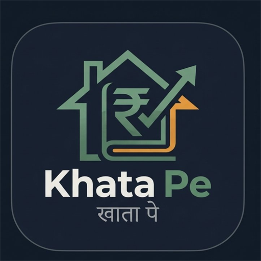

<div align="center">



# Khata Pe (खाता पे)
### *हर महीने का सही हिसाब — Smart Rental Management for Modern Indian Landlords*

[](https://flutter.dev)
[](https://dart.dev)
[](https://firebase.google.com)
[](#)
[](#)

<br/>

<a href="https://github.com/rudranagar4/khata-pe/raw/main/release/khata-pe.apk">
  
</a>

<br/><br/>

</div>

---

## 📖 About Khata Pe

**Khata Pe (खाता पे)** is a purpose-built, high-performance rental ledger and property management mobile application designed specifically for **Indian Landlords, PG Owners, and Real Estate Managers**.

Managing rents across scattered flats, shops, and rooms through paper registers or messy WhatsApp chats leads to forgotten arrears, awkward payment reminders, and lost accounts. **Khata Pe replaces all of that with a sleek, dark-slate UI, automated rent tracking, one-tap WhatsApp billing reminders, stamped PDF receipts, and offline-first cloud sync.**

---

## ⚡ Key Highlights & Features

### 🏢 1. Flexible Property & Unit Architecture
* **Any Property Type**: Manage Buildings, Apartments, Independent Floors, Commercial Complexes, and PGs.
* **Automatic Room Generation**: Configure default rents, security deposits, and starting room numbers (e.g. 101, 102...).
* **Real-time Occupancy Radar**: Instantly view vacant vs occupied units, current tenant details, and expected monthly collections at a glance.

### 👥 2. Complete Tenant Lifecycle
* **Indian KYC Compliant**: Store tenant details with identity proof support (**Aadhaar Card**, **PAN Card**, **Voter ID**, Driving License).
* **Room Allotment & Handover**: Single-tap room assignment with automated move-in date tracking and lease expiry reminders.
* **Move-out & Settlement**: Seamlessly process tenant vacating with automatic security deposit refund accounting.

### 📒 3. Automated Monthly Rent Ledger
* **Smart Status Badges**: Automatically categorizes dues into **Paid**, **Pending**, **Partial**, and **Overdue**.
* **Flexible Payments**: Record full payments, advance collections, partial settlements, and custom payment modes (UPI, Cash, Bank Transfer, Cheque).
* **Historical Records**: Multi-month navigation to audit previous rental histories at any time.

### 💬 4. Single-Tap WhatsApp Reminders
* **Pre-composed Hindi & English Templates**: Send personalized, polite rent reminder messages without typing a single word.
* **Dynamic Smart Tags**: Automatically injects `{tenantName}`, `{amount}`, `{month}`, and landlord name into every greeting.

### 🧾 5. Digital Receipts & 5-Sheet Excel Reports
* **Stamped PDF Receipts**: Generate professional, watermarked digital rent receipts ready to share directly over WhatsApp.
* **Full Financial Audits**: Export a formatted **5-sheet Excel workbook** containing full property, tenant, rent ledger, and expense statements for income tax filing.

### 🔐 6. Maximum Security & Biometric Lock
* **Strict Biometric Protection**: Built-in App Lock supporting device Fingerprint and Face ID authentication.
* **SHA-256 Hashed Login**: Passwords are cryptographically protected; plaintext credentials are never stored or logged.
* **Brute-Force Shield**: Automated rate-limiting temporarily locks access after multiple failed login attempts.

### ☁️ 7. Offline-First Cloud Architecture
* **Zero Latency**: Local storage via `SharedPreferences` ensures the app opens and responds instantly, even without an active internet connection.
* **Cloud Firestore Sync**: Changes synchronize in real-time with Google Cloud Firestore in the background when connectivity is available.

---

## 📱 Download & Install APK

You can download and install the ready-to-run Android APK directly on your phone:

| Build | Direct Download Link | Alternative Mirror | Size |
| :--- | :--- | :--- | :--- |
| **Release APK (v1.0.0)** | [📥 **Direct Download APK**](https://github.com/rudranagar4/khata-pe/raw/main/release/khata-pe.apk) | [🌐 **Raw Mirror Link**](https://raw.githubusercontent.com/rudranagar4/khata-pe/main/release/khata-pe.apk) | ~58.4 MB |

> [!TIP]
> **How to install on your Android phone:**
> 1. Click the green **Direct Download** button or link above.
> 2. When your browser warns *"File might be harmful"*, click **Download anyway** (standard for APKs downloaded outside Google Play Store).
> 3. Once downloaded, tap the file in your notification bar or Downloads folder to install.
> 4. If prompted, toggle on *"Allow from this source"* in Settings.

---

## 🛠️ Tech Stack & Libraries

| Domain | Technology / Package | Purpose |
| :--- | :--- | :--- |
| **Framework** | [Flutter 3.x](https://flutter.dev) | Multiplatform UI toolkit |
| **Language** | [Dart 3.x](https://dart.dev) | Sound null-safe application code |
| **State Management** | `flutter_riverpod: ^2.6.1` | Reactive, decoupled state architecture |
| **Routing** | `go_router: ^17.5.0` | Declarative, URL-driven app navigation |
| **Backend / Database** | `cloud_firestore: ^7.1.0` | Google Cloud NoSQL realtime sync |
| **Biometrics** | `local_auth: ^3.0.2` | Biometric fingerprint & Face ID security |
| **Cryptography** | `crypto: ^3.0.6` | SHA-256 credential hashing |
| **Spreadsheets** | `excel: ^4.0.6` | 5-sheet automated tax report generation |
| **PDF Generation** | `pdf: ^3.12.0` & `printing: ^5.14.3` | Stamped digital rent receipts |
| **Charts & Metrics** | `fl_chart: ^1.3.0` | Revenue and occupancy analytics |

---

## 📂 Project Structure

```
khatape/
├── android/                   # Native Android configuration & Gradle build scripts
├── assets/
│   └── images/                # Khata Pe logo & branding assets
├── ios/                       # Native iOS runner & Xcode project
├── lib/
│   ├── core/
│   │   ├── constants/         # App Colors (Dark Slate / Emerald theme)
│   │   ├── router/            # GoRouter configuration & routes
│   │   ├── services/          # LocalAuth, FirebaseSync, Excel, PDF, WhatsApp services
│   │   ├── theme/             # Custom dark theme configuration
│   │   └── widgets/           # Reusable brand components & buttons
│   ├── features/
│   │   ├── auth/              # Login, Biometric App Lock, Onboarding & User Profile
│   │   ├── expenses/          # Maintenance, repairs & property expense logs
│   │   ├── properties/        # Building & unit architecture, room grids
│   │   ├── rent/              # Ledger calculations, dashboard & payment recording
│   │   ├── reports/           # Financial analytics & export utilities
│   │   ├── settings/          # Biometric lock, WhatsApp templates, backup
│   │   └── tenants/           # Tenant profiles, KYC details, lease history
│   ├── firebase_options.dart  # Firebase platform configuration
│   └── main.dart              # Application entry point
├── release/                   # Distribution release APK binary
├── test/                      # 28+ unit, widget, and integration test suites
└── pubspec.yaml               # Dependencies & asset declarations
```

---

## 🚀 Getting Started for Developers

### Prerequisites
* [Flutter SDK](https://docs.flutter.dev/get-started/install) (`>= 3.11.3`)
* [Android Studio](https://developer.android.com/studio) or VS Code with Flutter extension
* Java JDK 17+

### Local Setup
```bash
# 1. Clone the repository
git clone https://github.com/rudranagar4/khata-pe.git
cd khata-pe

# 2. Install dependencies
flutter pub get

# 3. Run automated tests (All 28 tests)
flutter test

# 4. Launch the app on a connected device / emulator
flutter run
```

### Building Release APK
```bash
flutter build apk --release
```
The compiled APK will be output at:
`build/app/outputs/flutter-apk/app-release.apk`

---

## 🔒 Security & Access

* **Owner Login**: Configured for registered landlord credentials.
* **Quick Demo Access**: A one-tap **Quick Demo Login (डेमो लॉगिन)** button is provided on the login screen for testing and exploring without entering credentials.

---

<div align="center">

Made with ❤️ for Indian Landlords & Property Managers • **Khata Pe v1.0.0**

</div>
